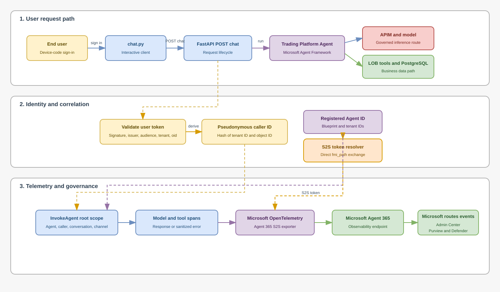
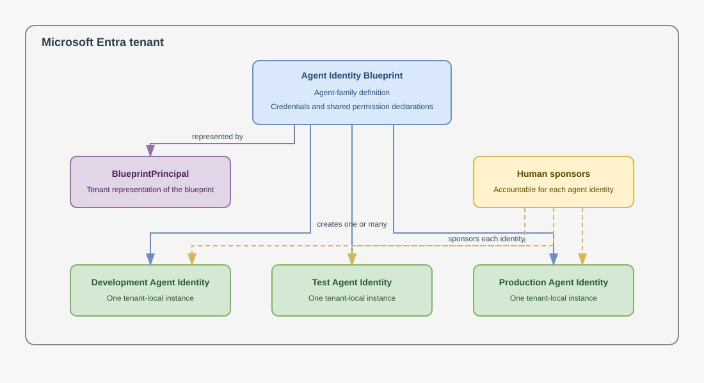
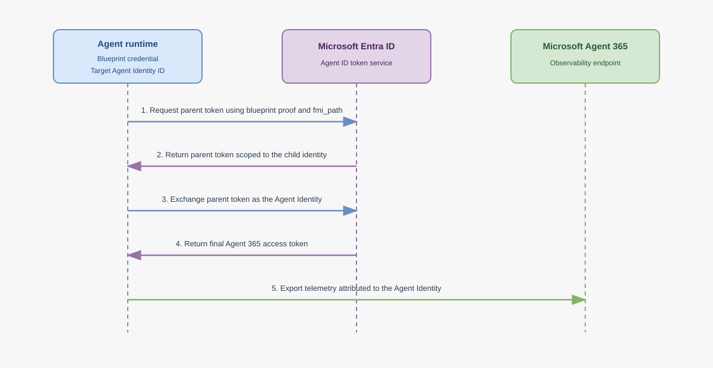

# Microsoft Agent 365 Developer Guide

## 1. Purpose

This is the canonical developer guide for bringing a self-hosted,
code-based line-of-business (LOB) agent into Microsoft Agent 365 without
replacing its framework, hosting platform, model gateway, tools, or data
stores.

The Python Trading Platform Agent is the reference implementation. It proves a
repeatable method for adding:

- Microsoft Entra Agent ID identity and lifecycle governance.
- Microsoft Agent 365 registration and inventory.
- Microsoft OpenTelemetry instrumentation and Agent 365 export.
- Per-invocation agent, conversation, and validated Entra caller attribution.
- Purview, Defender, and Microsoft 365 Admin Center downstream visibility.
- Explicit privacy, failure-isolation, validation, and rollback controls.

Use this guide to design and implement the code integration. Use the
[provisioning runbook](./provisioning_runbook.md) for tenant changes, the
[verification process](./verification_process.md) for operator acceptance, and
the [operations runbook](./operations_runbook.md) after deployment.

### Normative terms

- **MUST** identifies a requirement needed for identity correctness, privacy,
  or supported Agent 365 behavior.
- **SHOULD** identifies the repository's recommended implementation pattern.
- **MAY** identifies an optional capability or implementation choice.

## 2. Scope and current implementation status

This guide applies when the agent:

- Is built and hosted by the application team.
- Uses an agent SDK or framework, including Microsoft Agent Framework.
- Is not already covered by a built-in Agent 365 platform integration.
- Needs code-level identity and observability integration.

The Trading Platform Agent currently uses:

| Concern | Reference implementation |
|---|---|
| Agent framework | Microsoft Agent Framework |
| API boundary | FastAPI `POST /chat` |
| Model path | Azure OpenAI-compatible endpoint through governed APIM |
| Tool path | Agent Framework functions backed by PostgreSQL operations |
| Human authentication | Device-code user token sent by `chat.py` |
| Agent 365 authentication | Blueprint-backed, app-only S2S token |
| Agent 365 export | Microsoft OpenTelemetry Distro |
| Content policy | Metadata-only by default |
| Runtime container | Python 3.11 |
| Validated observability package | `microsoft-opentelemetry==1.3.9` |

Current validation status:

| Surface | Status |
|---|---|
| Agent Identity Blueprint and BlueprintPrincipal | Implemented |
| Sponsored local Agent Identity | Implemented |
| Agent 365 inventory registration | Implemented |
| S2S token acquisition and refresh | Implemented and tested |
| Root invocation and caller attribution | Implemented and tested |
| Purview Activity Explorer ingestion | Verified |
| Admin Center inventory | Verified |
| Admin Center per-agent Activity rendering | Requires conclusive verification |
| Defender `CloudAppEvents` Agent 365 rows | Not yet present |
| On-premises `prd` certificate or federation | Target design, not implemented |

## 3. Choose the correct Agent 365 integration path

Microsoft documents three broad integration mechanisms:

1. Built-in integration for supported Microsoft-hosted platforms.
2. Registry synchronization for supported external platforms.
3. Developer integration for self-hosted, code-based agents.

The Trading Platform Agent uses the third path because it is a self-hosted
Microsoft Agent Framework application. The Agent 365 integration extends the
existing agent; it does not become the agent framework.

Before adding code, developers MUST confirm that built-in integration or
registry synchronization does not already provide the required capabilities.
See [Choose an Agent 365 integration option](https://learn.microsoft.com/en-us/microsoft-agent-365/developer/choose-integration-option).

## 4. Logical design

### 4.1 End-to-end application wiring



The editable source is
[a365-lob-app-wiring.drawio](../images/a365-lob-app-wiring.drawio).

The design has three related but independent paths:

1. The user invokes the existing application.
2. The application resolves human and agent identity for correlation.
3. Microsoft OpenTelemetry exports Agent 365 telemetry asynchronously.

Agent 365 is not in the model or database data path. An Agent 365 outage MUST
NOT turn a successful model or tool operation into a failed user request.

### 4.2 Agent identity object model



The editable source is
[a365-blueprint-object-model.drawio](../images/a365-blueprint-object-model.drawio).

The identity model separates:

- **Agent Identity Blueprint:** The agent-family application object. It owns
  credentials, protocol properties, and declared inheritable permissions.
- **BlueprintPrincipal:** The blueprint's tenant service principal.
- **Agent Identity:** One tenant-local agent instance with its own client ID,
  object ID, sponsor, direct permissions, sign-ins, and audit trail.
- **Human sponsor:** The accountable person or group for purpose and
  lifecycle decisions.

Credentials MUST remain on the blueprint. Developers MUST NOT add credentials
directly to a child Agent Identity.

### 4.3 Identity paths are separate

The implementation has several credentials with different trust purposes:

| Path | Identity or credential | Purpose |
|---|---|---|
| User to local API | Device-code bearer token | Authenticate the interactive caller |
| API to APIM/model | User bearer token plus server-held APIM subscription key | Authorize the governed model request |
| Runtime to Agent 365 | Blueprint-backed Agent Identity S2S token | Authenticate telemetry and attribute the agent instance |
| Runtime to PostgreSQL | Database credential | Authorize portfolio data operations |

These credentials are not interchangeable.

The user token is not the Agent 365 exporter token. Recording the validated
caller identity in telemetry does not grant that user access to Agent 365 or any
downstream resource.

### 4.4 Responsibility by application layer

| Layer | Primary responsibility | What it does not own |
|---|---|---|
| Process entry point | Initialize Microsoft OpenTelemetry before instrumented imports | Per-request spans or business behavior |
| Agent construction | Bind the registered Agent ID to `ChatAgent.id`; define model, instructions, and tools | Exporter authentication or request lifecycle |
| API request lifecycle | Validate caller, open one root scope, run the agent, record outcome | Token-exchange protocol or exporter internals |
| Observability runtime | Load settings, acquire and refresh S2S token, build Agent 365 details, configure exporter, flush | Model authorization or business tools |
| Agent Framework and Distro | Emit supported model, tool, HTTP, and database child telemetry | Application-specific privacy approval |
| Tenant services | Ingest, govern, analyze, and route eligible events | Application runtime availability |

This separation is intentional. It keeps Agent 365 concerns out of the agent's
business instructions and tool implementations.

### 4.5 Trace model

One accepted chat request maps to one root invocation:

```text
invoke_agent
  +-- chat or model inference
  +-- execute_tool
  |     +-- database or HTTP dependency
  +-- chat or model inference
  +-- output_messages
```

The root operation MUST be `invoke_agent`. Supported child operations appear
only when the relevant framework or dependency instrumentation is active.
Developers MUST validate the emitted trace instead of assuming every library
call is instrumented.

The current root scope covers `POST /chat`. Structured REST endpoints such as
`GET /accounts` and `POST /query` are not Agent 365 invocations unless they
are called as tools during an agent run or are explicitly instrumented later.

## 5. Design principles

### 5.1 Extend the agent; do not rebuild it

Agent 365 MUST preserve existing:

- Agent framework behavior.
- Model routing and authorization.
- Tool contracts.
- Data access.
- Hosting and networking.
- Error semantics.

Run baseline tests before integrating Agent 365 and rerun them afterward.

### 5.2 Use one registered identity consistently

The same environment-specific Agent Identity client ID MUST be used as:

- `A365_AGENT_ID`.
- `ChatAgent.id`.
- The `fmi_path` target.
- The final token subject.
- Agent 365 baggage and `AgentDetails.agent_id`.
- The identity represented by the S2S export URL.

Mixing blueprint ID, blueprint object ID, Agent Identity object ID, and Agent
Identity client ID can produce HTTP 403 responses or unattributed telemetry.

### 5.3 Put the root scope at the business invocation boundary

The API knows when one user-visible agent run begins and ends. The root
`InvokeAgent` scope therefore belongs around `agent.run`, not inside the
agent constructor or an individual tool.

### 5.4 Centralize telemetry infrastructure

Token exchange, exporter configuration, Agent 365 scope construction, health,
and flush behavior SHOULD live in one observability module. Business modules
SHOULD receive no raw telemetry credentials.

### 5.5 Fail explicitly, but isolate telemetry failure

Invalid static configuration SHOULD fail before the server starts. Runtime
authentication or exporter failure SHOULD:

- Produce sanitized logs.
- Mark Agent 365 health as degraded.
- Suppress the invocation scope if no valid token exists.
- Leave normal agent behavior available.

### 5.6 Make content capture an explicit policy

Metadata-only operation is the baseline. Full-content capture MAY be enabled
only for an approved, time-bounded nonproduction policy test.

## 6. Reference code map

| Concern | Reference file | Key responsibility |
|---|---|---|
| Process bootstrap | [main.py](../lob/wealth/portfolio-manager/main.py) | Initialize telemetry before Uvicorn imports the API |
| Agent construction | [agents/trading_platform_agent.py](../lob/wealth/portfolio-manager/agents/trading_platform_agent.py) | Bind Agent ID and define model, instructions, and tools |
| Request lifecycle | [api/main.py](../lob/wealth/portfolio-manager/api/main.py) | Validate caller and wrap `agent.run` in one root scope |
| Caller validation | [api/user_identity.py](../lob/wealth/portfolio-manager/api/user_identity.py) | Validate Entra token and return the human object ID and available UPN/name |
| Telemetry runtime | [observability/a365.py](../lob/wealth/portfolio-manager/observability/a365.py) | S2S authentication, scope creation, exporter, status, and flush |
| Interactive client | [chat.py](../lob/wealth/portfolio-manager/chat.py) | Acquire and refresh the human user's device-code token |
| Business operations | [operations/trading_platform_operations.py](../lob/wealth/portfolio-manager/operations/trading_platform_operations.py) | PostgreSQL-backed LOB operations |
| Tool adapters | [tools/trading_platform_tool.py](../lob/wealth/portfolio-manager/tools/trading_platform_tool.py) | Expose business operations as agent functions |
| Container configuration | [docker-compose.yaml](../lob/wealth/portfolio-manager/docker-compose.yaml) | Pass environment-specific settings |
| Safe example configuration | [env.sample](../lob/wealth/portfolio-manager/env.sample) | Document non-secret defaults |

## 7. Implementation methodology

### Phase 0: Establish a behavioral baseline

Before adding Agent 365:

1. Start the application using its normal workflow.
2. Run one model-only request.
3. Run representative tool requests.
4. Confirm authentication, errors, rate limits, conversation continuity, and
   shutdown behavior.
5. Record test commands and expected outcomes.

Do not proceed if the baseline is already unstable.

### Phase 1: Register the governed identity

Provision in this order:

1. Agent Identity Blueprint.
2. BlueprintPrincipal.
3. Required `managerApplications` relationship.
4. Approved blueprint credential or federation.
5. Environment-specific Agent Identity.
6. Human or group sponsor.
7. Only approved permissions.
8. Agent 365 inventory registration.

Store non-secret identifiers in generated configuration. Store no secret,
token, device code, or private key in the repository.

Before validating export, confirm that at least one tenant user has Microsoft
365 E7 or Microsoft Agent 365 assigned. Microsoft documents that ingestion can
return HTTP 200 while dropping telemetry when this prerequisite is absent.

See the [blueprint guide](./blueprints.md) and
[provisioning runbook](./provisioning_runbook.md).

### Phase 2: Define the configuration contract

The current implementation uses:

| Setting | Secret | Current requirement | Default |
|---|---:|---|---|
| `ENABLE_A365_OBSERVABILITY` | No | Feature flag | `false` |
| `A365_TENANT_ID` | No | Required when enabled | None |
| `A365_BLUEPRINT_CLIENT_ID` | No | Required when enabled | None |
| `A365_BLUEPRINT_CLIENT_SECRET` | Yes | Required by the current local exchange | None |
| `A365_AGENT_ID` | No | Required when enabled | None |
| `A365_RECORD_CONTENT` | No | Optional explicit policy | `false` |
| `A365_CHANNEL_NAME` | No | Optional stable channel | `local-cli` |
| `A365_SERVER_ADDRESS` | No | Optional endpoint metadata | `localhost` |
| `A365_SERVER_PORT` | No | Optional endpoint metadata | `SERVER_PORT` or `8989` |
| `A365_EXPORT_DEBUG` | No | Optional local diagnostics | `false` |
| `A365_MAX_QUEUE_SIZE` | No | Optional exporter tuning | `2048` |
| `A365_SCHEDULED_DELAY_MS` | No | Optional exporter tuning | `5000` |
| `A365_EXPORT_TIMEOUT_MS` | No | Optional exporter tuning | `30000` |
| `A365_MAX_EXPORT_BATCH_SIZE` | No | Optional exporter tuning | `512` |

Static validation MUST reject missing required values, malformed UUIDs, and
invalid endpoint metadata before Uvicorn starts.

### Phase 3: Initialize telemetry before instrumented modules

The application entry point loads environment variables and initializes Agent
365 before importing Uvicorn:

```python
from observability.a365 import initialize_a365_observability

initialize_a365_observability(os.environ)

import uvicorn
```

This order is required so Microsoft OpenTelemetry can patch supported
libraries before the API imports them.

Developers MUST start the reference application with `python main.py` or an
equivalent entry point that performs this initialization. Starting
`uvicorn api.main:app` directly bypasses the bootstrap and is unsupported for
Agent 365 observability unless initialization is added elsewhere.

### Phase 4: Bind the registered identity to the framework agent

The agent factory reads the registered identity only when observability is
enabled:

```python
a365_agent_id = (
    os.getenv("A365_AGENT_ID", "").strip()
    if observability_enabled
    else None
)

agent = ChatAgent(
    id=a365_agent_id,
    name="TradingPlatformAgent",
    ...
)
```

This binding provides framework-level identity correlation. It does not
authenticate the exporter and does not create the root invocation scope.

The agent factory SHOULD remain focused on:

- Model client construction.
- Agent ID, name, and description.
- System instructions.
- Tool registration.

### Phase 5: Implement Agent Identity S2S authentication



The editable source is
[a365-agent-token-flow.drawio](../images/a365-agent-token-flow.drawio).

Microsoft recommends S2S export for registered blueprint agents. The current
Python runtime implements the documented two-step agentic identity chain
directly:

1. Use the blueprint client ID and credential to request
   `api://AzureADTokenExchange/.default`.
2. Set `fmi_path` to the child Agent Identity client ID.
3. Use the returned parent token as the child identity's client assertion.
4. Request
   `api://9b975845-388f-4429-889e-eab1ef63949c/.default`.
5. Validate that the final token:
   - Targets the expected Agent 365 Observability audience.
   - Is app-only.
   - Has the configured Agent Identity as its subject.
   - Has a valid expiration.
6. Cache only the final token in memory.
7. Refresh before expiry.

Microsoft examples use helper APIs plus MSAL. The direct HTTP implementation is
a lower-level implementation of the same chain. It MUST remain covered by
focused exchange and claim-validation tests.

### Phase 6: Configure the Microsoft OpenTelemetry Distro

The application enables the Distro once:

```python
use_microsoft_opentelemetry(
    resource=Resource.create(
        {
            "service.name": settings.service_name,
            "service.version": settings.service_version,
        }
    ),
    enable_a365=True,
    a365_token_resolver=runtime.resolve_token,
    a365_use_s2s_endpoint=True,
    a365_enable_observability_exporter=True,
    a365_exporter_disable_offline_storage=True,
    a365_suppress_invoke_agent_input=not settings.record_content,
    enable_sensitive_data=settings.record_content,
)
```

Initialization MUST occur once per process. Offline storage remains disabled
because unencrypted telemetry can contain operational or business data.

### Phase 7: Keep human authentication separate

When `AZURE_AUTH_MODE=device-code`:

1. `chat.py` creates one `DeviceCodeCredential`.
2. It requests a cached or refreshed user token before authenticated commands.
3. It sends the token to the local API.
4. The API validates the token before using it for caller attribution.
5. The per-request model client forwards the user token to the governed APIM
   route.

One console process remains associated with the account used at initial
sign-in. Testing another user requires restarting the console and choosing the
other account.

This is application authentication, not Agent 365 OBO export. Agent 365
telemetry still uses the app-only S2S Agent Identity token.

### Phase 8: Validate and attribute the human caller

The API validates:

- Signature and signing key.
- Allowed algorithm.
- Audience.
- Issuer.
- Expiration.
- Tenant ID.
- Entra object ID.

Explicit app-only tokens are rejected as human callers. After validation,
the API returns an immutable caller identity containing the tenant and object
IDs, the available `preferred_username` or legacy `upn`, and `name`.
Optional identity claims must be strings when present.

The API MUST pass the actual validated object ID, not a hash, using:

```python
CallerDetails(
    user_details=UserDetails(
        user_id=caller.object_id,
        user_email=caller.upn,
        user_name=caller.name,
    )
)
```

Do not replace this with only a generic OpenTelemetry `user.id` attribute.
The same caller fields are added to request-scoped SDK baggage for child
span propagation. On `InvokeAgent` records, `user.id` maps to `UserKey`
and `user.email` maps to `UserId`. Tool/inference user fields can instead
describe the agent's own user account; correlate children to the root.
See the [Microsoft attribute reference](https://learn.microsoft.com/en-us/microsoft-agent-365/developer/observability-attribute-reference).
Caller identity is approved security metadata even when content recording is
disabled. Tokens, device codes, and unrelated claims MUST remain excluded.

### Phase 9: Create one root scope per accepted invocation

The `/chat` endpoint opens the root scope after caller validation and before
agent construction or execution:

```python
with a365_invoke_scope(
    request.session_id,
    caller.object_id if caller else None,
    request.message,
    user_email=caller.upn if caller else None,
    user_name=caller.name if caller else None,
) as telemetry_scope:
    response = await request_agent.run(request.message, thread=thread)
```

The observability runtime supplies:

- Hashed conversation and session IDs.
- Agent ID, blueprint ID, and tenant ID.
- Agent name, description, provider, and version.
- Validated human `CallerDetails`, when available.
- Channel and API endpoint.
- Agent 365 baggage.
- Prompt content only when explicitly enabled.

The session hash is correlation metadata, not authentication. Do not use an
email address, account ID, or raw bearer-token claim as a conversation ID.

### Phase 10: Let supported instrumentation create child spans

The framework agent runs inside the root scope. Supported Microsoft
OpenTelemetry instrumentation can therefore emit child spans for:

- Model inference.
- Tool execution.
- HTTP dependencies.
- Database dependencies.

Developers SHOULD prefer supported automatic instrumentation over duplicating
model or tool spans manually. Add manual spans only for a verified gap, and
follow the current semantic attribute reference.

### Phase 11: Record success and failure accurately

On success:

- Return the application response normally.
- Record response content only when content capture is enabled.
- Preserve the root span's successful completion.

On failure:

- Call `scope.record_error(error)` before application error translation.
- Preserve the original application error category.
- Avoid broad exception serialization.
- Never attach tokens, credentials, connection strings, SQL results, or raw
  business payloads.

Telemetry export failure MUST NOT trigger an automatic retry of the user's
model request.

### Phase 12: Manage startup, refresh, health, shutdown, and rollback

At startup:

- Build the agent or prepare client-supplied authentication.
- Initialize the database.
- Acquire the Agent 365 token.
- Start background refresh.

During operation:

- Recheck token readiness before each invocation.
- Report only safe readiness and sanitized error categories.

At shutdown:

- Stop background token refresh.
- Flush telemetry with a bounded timeout.
- Close the database pool.

Rollback is configuration-only:

```dotenv
ENABLE_A365_OBSERVABILITY=false
```

After restart, agent, APIM, tool, and database behavior must remain available.

## 8. Content and privacy policy

### 8.1 Default mode

`A365_RECORD_CONTENT=false` is the normal default in `local`, `dev`, `tst`,
and `prd`.

Do not export:

- Raw prompts or model responses.
- Account identifiers.
- Holdings, prices, or trade records.
- Tool arguments or results.
- SQL text or database results.
- Tokens, credentials, keys, device codes, or connection strings.

The exception is approved security identity metadata: registered tenant and
agent IDs, plus the validated human object ID and available UPN/display name.
These use the SDK's identity fields, not prompt content or general console
logging. Govern access and retention for this personally identifiable
metadata independently of `A365_RECORD_CONTENT`.

### 8.2 Approved nonproduction policy testing

`A365_RECORD_CONTENT=true` MAY be used only when:

1. Security, Privacy, and Compliance approve the test.
2. The environment and synthetic data are nonproduction.
3. Purview and Defender access, retention, residency, and billing are
   understood.
4. The setting is time-bounded.
5. A sanitized trace confirms the expected content.
6. The setting is returned to `false` afterward.

Configuration is not proof of effective privacy. Inspect the exported
attributes.

## 9. Failure semantics

| Failure | Expected application behavior | Expected Agent 365 behavior |
|---|---|---|
| Missing required static setting | Process fails before Uvicorn starts | No exporter |
| Invalid blueprint credential | Application starts; health is degraded | No root scope until token is ready |
| Wrong Agent Identity | Token subject validation fails | No export under the wrong identity |
| Expired token | Resolver rejects token and refreshes | Invocation may proceed without telemetry |
| Export timeout | User request remains independent | Bounded exporter failure is logged |
| APIM 429 | Return governed rate-limit error; do not retry automatically | Root operation records error |
| Tool or database error | Return controlled application failure | Root and supported child operations record failure |
| Invalid human token | Reject request with HTTP 401 | No accepted agent invocation |
| Purview or Defender delay | Application remains healthy | Continue correlation-based investigation |

Do not return success-shaped telemetry status when authentication failed. Do
not fail a valid user operation only because a downstream telemetry surface is
delayed.

## 10. Environment boundaries

Every runtime remains on premises and is promoted in the order
`local` -> `dev` -> `tst` -> `prd`.

| Concern | `local` | `dev` | `tst` | `prd` |
|---|---|---|---|---|
| Agent Identity | Dedicated local identity | Dedicated development identity | Dedicated test identity | Dedicated production identity |
| Blueprint boundary | May share a nonproduction blueprint when approved | May share the approved nonproduction boundary | May share the approved nonproduction boundary | Separate when trust or blast radius differs |
| Blueprint credential | Short-lived client secret in ignored `.env` | Environment-specific credential from an approved store | Environment-specific credential from an approved store | Certificate or approved workload federation target |
| Secret store | Git-ignored `.env` or developer store | Approved on-premises development store | Approved on-premises test store | Approved on-premises production store |
| Content capture | Metadata-only; approved synthetic tests only | Metadata-only; approved synthetic tests only | Metadata-only; approved policy tests only | Metadata-only unless separately approved |
| Sampling | 100 percent for focused validation | Defined nonproduction policy | Release-validation policy | Defined production policy with error/security retention |
| Export diagnostics | Opt-in locally | Sanitized operational logging | Sanitized release evidence | Sanitized operational logging |
| Runtime | On-premises workstation or container | On-premises development host | On-premises test host | On-premises production host |

The current code requires `A365_BLUEPRINT_CLIENT_SECRET` whenever Agent 365 is
enabled. Certificate or workload-federation authentication for the on-premises
`prd` runtime is a target architecture, not a capability that the current
runtime already implements.

## 11. Test strategy

### 11.1 Focused automated tests

| Behavior | Test evidence |
|---|---|
| Required settings and safe defaults | [test_a365_observability.py](../lob/wealth/portfolio-manager/test_a365_observability.py) |
| Two-step `fmi_path` exchange | [test_a365_observability.py](../lob/wealth/portfolio-manager/test_a365_observability.py) |
| Final token claims | [test_a365_observability.py](../lob/wealth/portfolio-manager/test_a365_observability.py) |
| Hashed conversation ID | [test_a365_observability.py](../lob/wealth/portfolio-manager/test_a365_observability.py) |
| Agent and caller details | [test_a365_observability.py](../lob/wealth/portfolio-manager/test_a365_observability.py) |
| Metadata-only and full-content modes | [test_a365_observability.py](../lob/wealth/portfolio-manager/test_a365_observability.py) |
| Token refresh lifecycle | [test_a365_observability.py](../lob/wealth/portfolio-manager/test_a365_observability.py) |
| Human token validation, exact caller fields, and API forwarding | [test_user_identity.py](../lob/wealth/portfolio-manager/test_user_identity.py) |
| Device credential reuse and refresh | [test_chat_auth.py](../lob/wealth/portfolio-manager/test_chat_auth.py) |
| Existing model error behavior | [test_rate_limit_handling.py](../lob/wealth/portfolio-manager/test_rate_limit_handling.py) |

Run the focused suite:

```powershell
Set-Location lob\wealth\portfolio-manager
.\.venv\Scripts\python.exe -m pytest `
  test_a365_observability.py `
  test_user_identity.py `
  test_chat_auth.py `
  test_rate_limit_handling.py
```

### 11.2 Runtime validation

Verify:

1. The application starts through the instrumented entry point.
2. `/health` reports API, database, agent, and Agent 365 status.
3. A metadata-only chat succeeds.
4. Model and tool behavior matches the baseline.
5. A controlled authentication failure returns HTTP 401.
6. A model or tool failure records an error without leaking content.
7. Disabling Agent 365 preserves application behavior.

### 11.3 Tenant validation

Verify each surface independently:

- Entra: blueprint, BlueprintPrincipal, child identity, sponsor, permissions,
  credentials, and workload sign-ins.
- Licensing: at least one tenant user has Microsoft 365 E7 or Microsoft Agent
  365 assigned.
- Agent Registry: correct environment-specific identity and inventory record.
- Purview: Activity Explorer event in the test time window.
- Defender: expected Agent 365 rows in `CloudAppEvents` when available.
- Admin Center: per-agent Activity when the tenant surface renders it.

Allow 30 to 90 minutes or longer for Activity Explorer and portal ingestion.
Some policy analytics require 24 hours or longer.

An exporter HTTP 200 is necessary but not sufficient proof of downstream
indexing.

## 12. Validation gates

### Gate A: Identity

- [ ] Blueprint exists.
- [ ] BlueprintPrincipal exists.
- [ ] Child Agent Identity exists for this environment.
- [ ] Sponsor is assigned.
- [ ] Required tenant observability license is assigned.
- [ ] Credentials exist only on the blueprint.
- [ ] `ChatAgent.id` matches the registered child identity client ID.
- [ ] Final token subject matches the same client ID.

### Gate B: Runtime

- [ ] Microsoft OpenTelemetry initializes before instrumented imports.
- [ ] Distro initializes once.
- [ ] S2S endpoint and resolver are enabled.
- [ ] Root `invoke_agent` scope wraps one logical agent run.
- [ ] Supported model and tool spans correlate beneath the root.
- [ ] Export failure does not fail the user request.
- [ ] Token refresh and shutdown flush are bounded.

### Gate C: Privacy

- [ ] Metadata-only is the effective default.
- [ ] Caller mapping uses the validated human Entra object ID, not a hash.
- [ ] Only approved identity claims are exported; user context is request-scoped.
- [ ] No credentials, tokens, SQL, or business records appear.
- [ ] Full-content testing has explicit approval and expiry.

### Gate D: Behavior

- [ ] Existing model, tool, database, rate-limit, and conversation tests pass.
- [ ] Agent 365 can be disabled without code changes.
- [ ] Authentication failures remain distinguishable from model, tool, and
      exporter failures.

### Gate E: Downstream evidence

- [ ] Agent appears in inventory.
- [ ] Purview ingestion is verified.
- [ ] Admin Center Activity is verified or explicitly pending.
- [ ] Defender ingestion is verified or explicitly blocked.
- [ ] Evidence records UTC time, agent ID, trace ID, and sanitized outcome.

## 13. Production hardening

Before production:

1. Replace the local blueprint secret flow with a certificate or approved
   workload federation supported by the on-premises production platform.
2. Use a dedicated production Agent Identity.
3. Decide whether production requires a separate blueprint credential
   boundary.
4. Move secrets to an approved secret store.
5. Define retention, residency, legal hold, and privacy request handling.
6. Define sampling, queue, timeout, and alert thresholds.
7. Establish sponsor, technical owner, security, privacy, and on-call contacts.
8. Test credential rotation, emergency disable, telemetry rollback, and
   retirement in nonproduction.
9. Pin and validate dependency upgrades.
10. Confirm Purview, Defender, and Admin Center roles for operators.

## 14. Reusing the pattern for another LOB agent

Use this sequence:

1. Inventory framework, entry point, invocation boundary, model calls, tools,
   data stores, and human authentication.
2. Confirm the Agent 365 developer-integration path is appropriate.
3. Choose the blueprint boundary based on purpose, publisher, credentials,
   inheritable permissions, ownership, and incident blast radius.
4. Register one environment-specific Agent Identity.
5. Establish a feature-gated configuration contract.
6. Initialize the Distro at the process entry point.
7. Bind the registered ID to the framework agent.
8. Implement the supported S2S token chain.
9. Put one root scope around the framework's logical run call.
10. Add approved caller attribution using validated Entra identity fields.
11. Validate automatic child instrumentation before adding manual spans.
12. Define content policy and failure isolation.
13. Add focused tests before tenant testing.
14. Validate each downstream surface independently.
15. Record production gaps and rollback.

Do not copy Trading Platform Agent business instructions, tool schemas, model
endpoint assumptions, or database configuration into another agent.

## 15. Anti-patterns

Avoid:

- Treating Agent 365 as the agent framework.
- Assigning the blueprint ID to `ChatAgent.id`.
- Putting credentials on a child Agent Identity.
- Reusing the human token as the exporter token.
- Treating caller attribution as authorization.
- Starting Uvicorn directly and bypassing instrumentation bootstrap.
- Creating one root scope per model call or tool call.
- Creating a root scope outside the accepted request lifecycle.
- Recording a generic `user.id` instead of supported `CallerDetails`.
- Exporting raw prompts or tool payloads by default.
- Retrying a model request because telemetry failed.
- Assuming HTTP 200 proves Purview, Defender, or Admin Center arrival.
- Claiming every framework operation is automatically instrumented without
  inspecting the trace.
- Claiming certificate or federation authentication is implemented when the
  runtime still requires a client secret.

## 16. Official Microsoft guidance crosswalk

Documentation reviewed October 14, 2026.

| Microsoft guidance | Repository implementation | Status |
|---|---|---|
| Use developer integration for self-hosted framework agents | Microsoft Agent Framework app integrates identity and observability in code | Aligned |
| Preserve the existing agent framework | Agent Framework, APIM, tools, and PostgreSQL remain unchanged | Aligned |
| Use Agent ID blueprint and child identities | Blueprint, BlueprintPrincipal, and sponsored child identity are registered | Aligned |
| Keep credentials on the blueprint | Local secret belongs to the blueprint | Aligned |
| Use S2S for registered blueprint-agent observability | Custom app-only resolver and S2S endpoint | Aligned |
| Use the two-step agentic identity chain | Direct `fmi_path` request and child assertion exchange | Aligned, lower-level implementation |
| Initialize Microsoft OpenTelemetry early | Initialization precedes Uvicorn and API imports | Aligned |
| Use a root `invoke_agent` span | API wraps `agent.run` in `InvokeAgentScope` | Aligned |
| Verify invocation, tool, and inference spans | Focused tests and runtime validation process | Partially verified in tenant |
| Verify Defender, Purview, and Admin Center | Purview ingestion verified; Admin Activity pending; Defender rows absent | Incomplete |
| Separate environment settings | `local` is implemented; on-premises `dev`, `tst`, and `prd` designs are documented | Partially implemented |
| Secure credentials | Secrets are ignored and omitted from examples | Aligned locally |
| Prefer stronger production identity | Certificate or approved federation is the documented on-premises `prd` target | Not yet implemented |

## 17. Documentation ownership

Use the documents according to their purpose:

| Document | Owns |
|---|---|
| This developer guide | Logical design, code responsibilities, and repeatable implementation method |
| [LOB application wiring](./lob_app_wiring.md) | File-by-file Trading Platform implementation detail |
| [Existing-agent onboarding](./onboarding_agents.md) | Concise onboarding sequence |
| [Blueprint guide](./blueprints.md) | Agent ID object and trust model |
| [Configuration reference](./configuration_reference.md) | Setting and compatibility contract |
| [Observability reference](./observability_reference.md) | Trace and attribute contract |
| [Provisioning runbook](./provisioning_runbook.md) | Tenant identity creation and cleanup |
| [Verification process](./verification_process.md) | Operator acceptance evidence |
| [Defender component guide](./components/defender_guide.md) | Defender inventory, hunting, detections, alerts, and incidents |
| [Purview component guide](./components/purview_guide.md) | Purview DSPM, activity, policy, alert, audit, and investigation surfaces |
| [Entra component guide](./components/entra_guide.md) | Entra identity objects, permissions, logs, risk, and access policy |
| [Security and privacy](./security_and_privacy.md) | Threats, data classification, and privacy controls |
| [Operations runbook](./operations_runbook.md) | Monitoring, rotation, incidents, rollback, and retirement |
| [Troubleshooting](./troubleshooting.md) | Symptom-based diagnosis |

When documents conflict:

1. Runtime code and focused tests describe implemented behavior.
2. This guide describes the approved engineering method.
3. The configuration and observability references define their contracts.
4. The operational ledger records environment-specific history and evidence.
5. Current Microsoft documentation governs product support and can supersede
   repository assumptions.

## 18. Definition of done

An Agent 365 developer integration is complete when:

- The correct integration mechanism is documented.
- Identity objects and sponsors exist.
- One registered child identity is used consistently.
- Existing agent behavior is preserved.
- Telemetry initializes before instrumented code.
- S2S authentication is validated and refreshed.
- One root scope wraps one agent invocation.
- Supported caller attribution is privacy preserving.
- Model and tool child telemetry is verified.
- Content policy is explicit and tested.
- Telemetry failure is isolated from application success.
- Automated tests pass.
- Runtime rollback works.
- Tenant surfaces are verified or accurately marked pending.
- Production identity, secret, retention, monitoring, and ownership gaps are
  resolved or explicitly accepted.

## 19. Official references

- [Choose an Agent 365 integration option](https://learn.microsoft.com/en-us/microsoft-agent-365/developer/choose-integration-option)
- [Connect existing agents to Agent 365](https://learn.microsoft.com/en-us/microsoft-agent-365/connect-existing-agents)
- [Agent 365 identity](https://learn.microsoft.com/en-us/microsoft-agent-365/developer/identity)
- [Agent 365 SDK overview](https://learn.microsoft.com/en-us/microsoft-agent-365/developer/agent-365-sdk)
- [Microsoft OpenTelemetry Distro](https://learn.microsoft.com/en-us/microsoft-agent-365/developer/microsoft-opentelemetry)
- [Observability authentication setup](https://learn.microsoft.com/en-us/microsoft-agent-365/developer/observability-authentication-setup)
- [Agent 365 SDK validation checklist](https://learn.microsoft.com/en-us/microsoft-agent-365/developer/validation-checklist)
- [Observability attribute reference](https://learn.microsoft.com/en-us/microsoft-agent-365/developer/observability-attribute-reference)
- [Direct OpenTelemetry troubleshooting](https://learn.microsoft.com/en-us/microsoft-agent-365/developer/direct-open-telemetry-troubleshooting)
